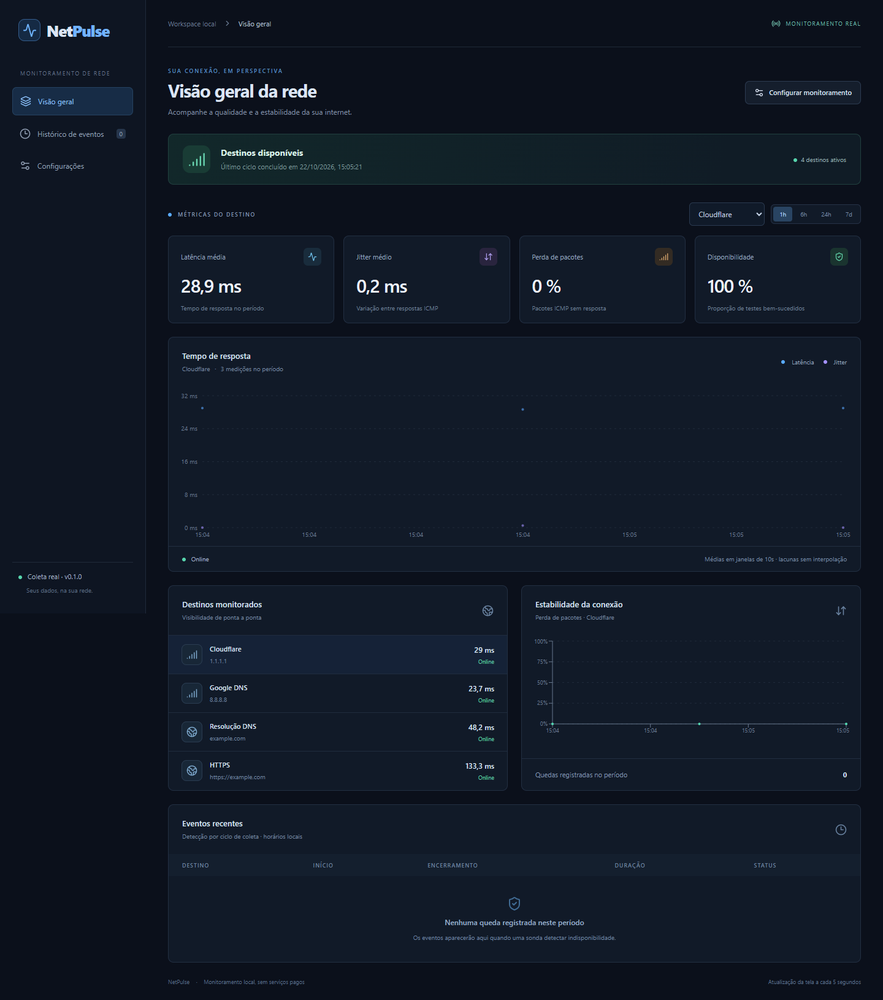
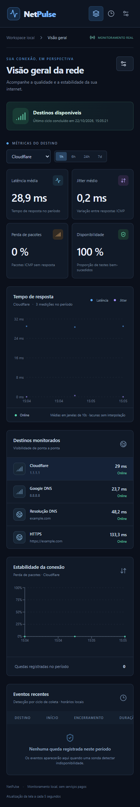

# NetPulse

**Versão 0.1.0 · Monitoramento local da qualidade da internet**

O NetPulse acompanha a estabilidade da conexão com medições reais de ping, DNS e HTTP/HTTPS. Um coletor Python registra os resultados em SQLite, enquanto o dashboard apresenta métricas, gráficos históricos e eventos de queda e recuperação.

Projetado para Windows e Linux, com arquitetura preparada para futura implantação no Raspberry Pi 5 com Raspberry Pi OS 64-bit. A versão 0.1.0 foi validada localmente no Windows; a execução em Linux e no Raspberry Pi ainda precisa de confirmação prática. Não exige Raspberry Pi, serviço pago ou conta externa para funcionar.

## Dashboard

Capturas reais da versão 0.1.0, obtidas no navegador com o coletor em execução. Os valores são observações daquele momento, sem dados demonstrativos ou edições na interface. Os destinos usados nas capturas são públicos; o banco e os endereços da rede local não fazem parte do repositório.



<details>
<summary>Visualização em celular</summary>



</details>

## Funcionalidades implementadas

- Ping ICMP para endereços IP e hostnames configuráveis, com descoberta de gateway IPv4 quando disponível.
- Latência, jitter, perda de pacotes e disponibilidade por destino.
- Resolução DNS do tipo A e consultas HTTP/HTTPS com tempo de resposta.
- Histórico de quedas e recuperações, inclusive encerramento por pausa ou remoção de destino.
- Dashboard responsivo em modo escuro, seleção de destino e períodos de 1h, 6h, 24h e 7 dias.
- Configuração de intervalos, timeout, quantidade de pacotes, retenção e até 32 destinos.
- Persistência em SQLite, API REST e documentação OpenAPI.
- Tratamento de timeout, erro de coleta, falhas de sondas e encerramento controlado.

Não inclui teste de velocidade, captura de pacotes ou IDS. Não há modo demonstrativo: valores ausentes aparecem como `—`.

## Tecnologias

| Camada | Tecnologias |
| --- | --- |
| Coletor e API | Python, asyncio, FastAPI, Uvicorn |
| Sondas | `ping` do sistema, dnspython e HTTPX |
| Persistência | SQLite com WAL |
| Interface | React, TypeScript, Vite, Recharts e Lucide |
| Testes | pytest, pytest-asyncio, Vitest e Chrome/Chromium via Playwright Core |
| Integração contínua | GitHub Actions: Python 3.11/3.12 e frontend em Windows/Linux |

## Requisitos

- **Python 3.11+**, recomendado 3.12, com suporte a `venv` e `pip`.
- **Node.js 22.12+** e npm.
- Git para clonar, ou o código extraído de um ZIP.
- Comando `ping` disponível. O Windows já o inclui; no Linux, veja os pacotes abaixo.
- Internet para instalar dependências e medir destinos externos. Destinos locais funcionam sem internet.

Instale Python e Node pelos seus canais oficiais e confirme `python --version` (ou `py --version`/`python3 --version`), `node --version` e `npm --version`. O código não depende de runtimes portáteis, `.tools` ou caminhos de um computador específico.

Após obter o código, abra o terminal na raiz `netpulse`. Não há URL de clonagem definida enquanto o repositório remoto não for criado.

## Instalação no Windows

Use PowerShell na raiz do projeto:

```powershell
py -3.12 -m venv .venv
.\.venv\Scripts\python.exe -m pip install -r requirements-dev.txt
Copy-Item .env.example .env
cd frontend
npm ci
npm run build
cd ..
```

Se não tiver o launcher `py`, use `python -m venv .venv` com Python 3.11+ no primeiro comando. Não é necessário ativar o ambiente virtual nem alterar a política de execução do PowerShell. Se a política bloquear `npm.ps1`, use `npm.cmd` nos comandos npm.

Inicie o backend na raiz:

```powershell
.\.venv\Scripts\python.exe -m backend.main
```

Abra **http://127.0.0.1:8000** para usar o dashboard compilado. Encerre com Ctrl+C.

## Instalação no Linux

Em Debian/Ubuntu e sistemas derivados:

```bash
sudo apt update
sudo apt install python3 python3-venv python3-pip iputils-ping iproute2
```

Instale também Node.js 22.12+ e npm pelos canais oficiais ou por seu gerenciador de versões. Confirme a versão, pois o pacote da distribuição pode ser anterior à exigida.

Na raiz do projeto:

```bash
python3 -m venv .venv
.venv/bin/python -m pip install -r requirements-dev.txt
cp .env.example .env
cd frontend
npm ci
npm run build
cd ..
.venv/bin/python -m backend.main
```

Abra **http://127.0.0.1:8000**. Para apenas executar o sistema, `requirements.txt` é suficiente; `requirements-dev.txt` também instala as ferramentas de teste. `requirements.lock.txt` registra o conjunto Python validado para esta versão e pode ser instalado com `python -m pip install -r requirements.lock.txt` usando o Python do ambiente virtual; `package-lock.json` fixa as dependências Node usadas por `npm ci`.

## Backend e frontend em desenvolvimento

Mantenha o backend da seção anterior em um terminal. Em um segundo terminal, dentro de `frontend`, execute:

```bash
npm run dev
```

- **Dashboard com atualização automática do código:** http://127.0.0.1:5173
- **Dashboard compilado:** http://127.0.0.1:8000
- **Documentação da API:** http://127.0.0.1:8000/docs
- **Saúde do coletor:** http://127.0.0.1:8000/health

O Vite encaminha `/api` para o backend na porta 8000. A porta 5173 é fixa: se estiver ocupada, encerre a outra instância. Execute `npm run build` novamente depois de alterar a interface para atualizar o dashboard da porta 8000. Inicie o backend depois do primeiro build para habilitar a entrega dos assets.

## Configuração

O `.env` na raiz aceita as variáveis de [.env.example](.env.example). Não envie seu arquivo real de ambiente para o Git.

| Variável | Padrão | Finalidade |
| --- | --- | --- |
| `NETPULSE_DB` | `data/netpulse.sqlite3` | Banco; caminho relativo à raiz do projeto |
| `NETPULSE_HOST` | `127.0.0.1` | Endereço de escuta |
| `NETPULSE_PORT` | `8000` | Porta do backend |
| `NETPULSE_CORS` | localhost/127.0.0.1 na porta 5173 | Origens permitidas, separadas por vírgula |

Intervalo, timeout, retenção e destinos são salvos no SQLite pela interface. O PUT de configuração aguarda o ciclo em andamento. Ciclos não se sobrepõem; quando a coleta demora mais que o intervalo, o próximo ciclo começa depois de sua conclusão. Até quatro destinos são coletados simultaneamente.

Destinos iniciais: Cloudflare (`1.1.1.1`), Google DNS (`8.8.8.8`), `example.com` para DNS/HTTPS e gateway detectado. Podem ser pausados ou removidos. O gateway é descoberto na inicialização por `route print -4` no Windows ou `ip -4 route show default` no Linux e só é incluído automaticamente na criação do banco. Confira o endereço se usar VPN ou múltiplas interfaces.

Para trocar tipo ou endereço de um destino, remova-o e crie outro; isso preserva a identidade do histórico. Pausar ou remover encerra a queda aberta com o motivo correspondente, sem simular recuperação.

Se usar frontend em outra origem, defina `VITE_API_URL` em `frontend/.env.local` e permita sua origem em `NETPULSE_CORS`. Se alterar a porta do backend durante o desenvolvimento, ajuste também o proxy de `frontend/vite.config.ts`.

## API REST

| Método | Rota | Resultado |
| --- | --- | --- |
| GET | `/health` ou `/api/health` | Coletor, último ciclo, gateway e modo real |
| GET | `/api/config` | Configuração atual |
| PUT | `/api/config` | Substituição validada e atômica da configuração |
| GET | `/api/dashboard?hours=24&target_id=1` | Métricas, séries e eventos; destino opcional |
| GET | `/docs` | Interface OpenAPI |

As medições atuais ficam em `targets[].latest`, as estatísticas em `targets[].stats`, os gráficos em `history` e as quedas em `outages`.

## Interpretação e limitações conhecidas

- **Latência:** média dos RTTs ICMP reconhecidos por ciclo. Respostas Windows `<1 ms` são registradas pelo limite superior de 1 ms. DNS mede a resolução A; HTTP mede até os cabeçalhos da resposta final, incluindo conexão, TLS e redirecionamentos, sem baixar o corpo.
- **Jitter:** média das diferenças absolutas entre RTTs recebidos no ciclo; exige duas respostas. Não é jitter RTP. Respostas perdidas são ignoradas no cálculo.
- **Perda:** proporção de pacotes ICMP enviados sem resposta. Tentativas com falha local ou saída não reconhecida são excluídas. DNS/HTTP exibem `—` para perda e jitter.
- **Disponibilidade:** proporção de ciclos bem-sucedidos entre resultados conhecidos. Ping tem sucesso com ao menos uma resposta; HTTP aceita status 200–399 após redirecionamentos; DNS exige resposta A. Erros de coleta desconhecidos não criam quedas nem entram no denominador.
- **Quedas:** detecção no primeiro ciclo com falha e recuperação no primeiro sucesso, por destino. Falha isolada não comprova queda geral da internet. A precisão depende do intervalo e duração do ciclo.
- **Serviço parado:** não há medição. Uma queda aberta pode incluir o período sem coleta até haver nova evidência. Ausência de eventos nesse período não comprova disponibilidade.
- **Histórico:** cerca de 360 janelas por destino nos gráficos; estatísticas usam as amostras brutas. Lacunas permanecem nulas. Eventos têm limite de 200 por consulta. Retenção padrão de 30 dias.
- **Rede:** ICMP pode ser bloqueado. O resolvedor DNS pode usar cache externo à biblioteca. HTTP valida certificados e ignora proxies de ambiente. IPv6 externo, outros idiomas e cenários com VPN precisam de validação local.
- **Acesso:** a API não tem autenticação. Mantenha o padrão de escuta local; para LAN confiável, configure `NETPULSE_HOST=0.0.0.0` e restrinja o acesso via firewall. Não exponha a porta à internet. Quem altera destinos pode consultar serviços acessíveis ao coletor.
- **Implantação:** use uma instância/worker por banco. Linux, Raspberry Pi, systemd, consumo de recursos e estabilidade prolongada ainda não foram validados em hardware nesta versão.

## Testes e integração contínua

Na raiz, com o ambiente virtual instalado:

```powershell
# Windows
.\.venv\Scripts\python.exe -m pytest -q
.\.venv\Scripts\python.exe -m pip check
```

```bash
# Linux
.venv/bin/python -m pytest -q
.venv/bin/python -m pip check
```

No frontend:

```bash
cd frontend
npm test
npm run build
```

Os testes Python usam SQLite temporário, resultados controlados e integração HTTP/ICMP em loopback. O teste de queda HTTP percorre respostas reais 200 → 503 → 200. Dados simulados pertencem apenas aos testes e não alimentam a aplicação.

Para diagnóstico real de loopback, gateway, internet, DNS e HTTPS, execute `python -m scripts.smoke` usando o Python do seu ambiente virtual. Uma falha pode indicar restrição da rede, não necessariamente defeito no software.

Com backend e Vite em execução, `npm run test:browser` em `frontend` valida os dois dashboards no Chrome/Chromium instalado. Use `CHROME_PATH` se o navegador não estiver em um caminho padrão. O teste consulta dados reais, salva a configuração atual sem modificá-la e grava relatórios/capturas em `artifacts/browser/`, ignorado pelo Git. Sem dados de ping disponíveis, esse teste exige preparar um destino acessível.

O [workflow de CI](.github/workflows/ci.yml) executa testes Python 3.11/3.12, testes frontend e build em Windows e Linux. Não publica nem faz deploy. Sua primeira execução no GitHub só acontecerá depois do envio autorizado do código. Consulte [VALIDATION.md](VALIDATION.md) para distinguir resultados locais executados de verificações ainda pendentes.

## Raspberry Pi 5 — implantação futura

Procedimento planejado, ainda não validado no dispositivo:

1. Instale Raspberry Pi OS **64-bit**, Python 3.11+, `python3-venv`, `iputils-ping` e `iproute2`.
2. Copie o código para `/opt/netpulse`, sem ambientes virtuais, dependências, bancos ou arquivos de ambiente de outra máquina.
3. Crie `.venv` no Pi e instale `requirements.txt`. Copie `.env.example` para `.env`.
4. Compile `frontend/dist` com Node 22.12+ ARM64 no Pi, ou copie esse build de outra máquina. Para executar o build pronto, o Pi só precisa do backend Python e do ping.
5. Crie um usuário de serviço, prepare o diretório de dados e revise [deploy/netpulse.service](deploy/netpulse.service).

Após copiar o código e criar o ambiente conforme a instalação Linux:

```bash
sudo useradd --system --home /opt/netpulse --shell /usr/sbin/nologin netpulse
sudo mkdir -p /opt/netpulse/data
sudo chown -R netpulse:netpulse /opt/netpulse
sudo cp /opt/netpulse/deploy/netpulse.service /etc/systemd/system/netpulse.service
sudo systemctl daemon-reload
sudo systemctl enable --now netpulse
sudo systemctl status netpulse
journalctl -u netpulse -f
```

Confirme permissões ICMP como usuário `netpulse`; não execute toda a aplicação como root para contornar uma configuração do ping. Valide encerramento, consumo de CPU/RAM, temperatura, armazenamento e recuperação após falta de energia. Um SSD é preferível para escrita prolongada.

## Dados e manutenção

O banco padrão fica em `data/` e não é versionado. Para backup simples consistente, pare o coletor antes de copiar o SQLite; para backup online, use a API de backup do SQLite. A retenção exclui medições antigas e eventos encerrados. O SQLite reutiliza páginas liberadas; `VACUUM`, com backup e serviço parado, pode compactar o arquivo.

## Estrutura do projeto

```text
.github/workflows/  Testes e build no GitHub Actions
backend/           FastAPI, coletor, sondas e SQLite
frontend/          React, TypeScript, gráficos e testes
tests/             Testes Python
scripts/           Diagnóstico real de rede
deploy/            Modelo systemd para futura implantação
docs/screenshots/  Capturas reais do dashboard
.env.example       Configuração de ambiente de referência
VALIDATION.md      Evidências e limites da validação
```

## Licença

Nenhuma licença de uso foi definida para a versão 0.1.0, por decisão do autor. Não há arquivo `LICENSE` nesta versão; a escolha foi adiada.
